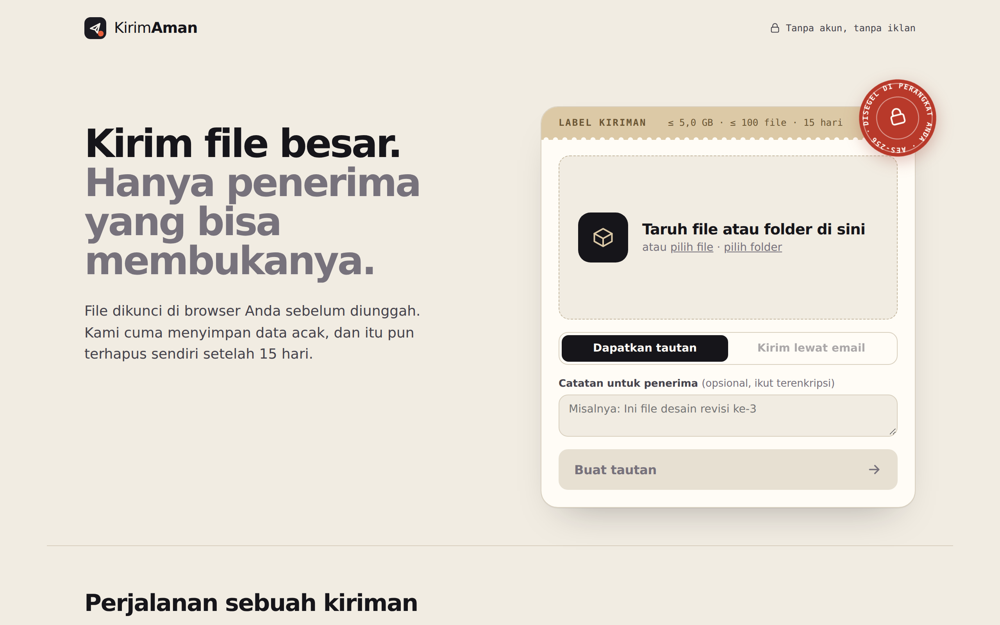
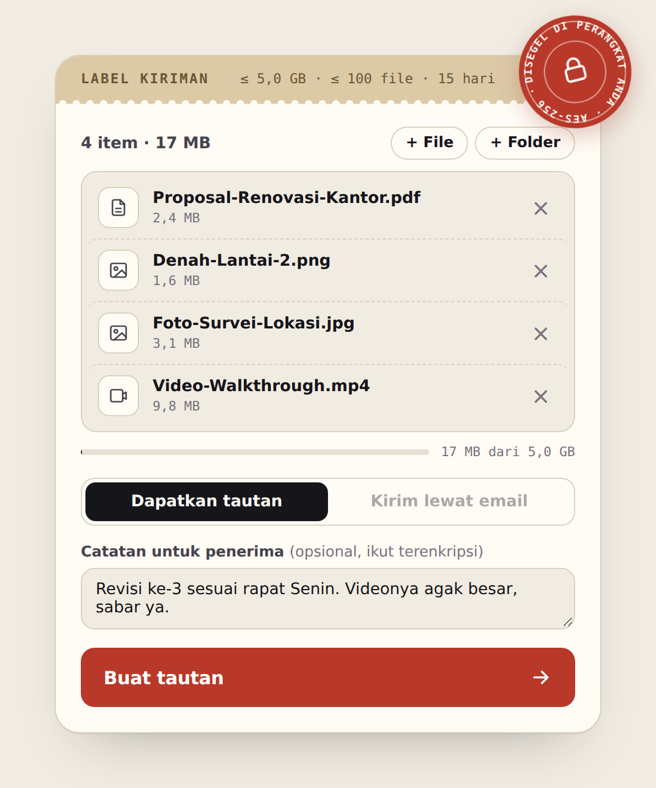
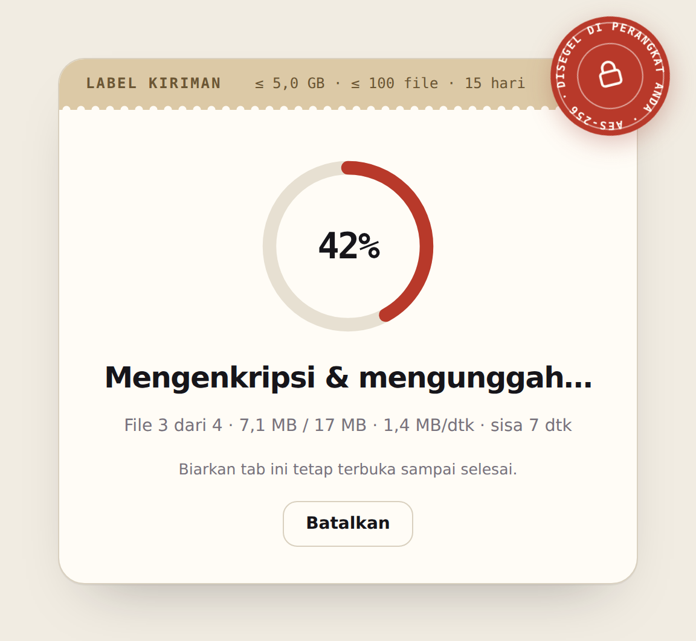
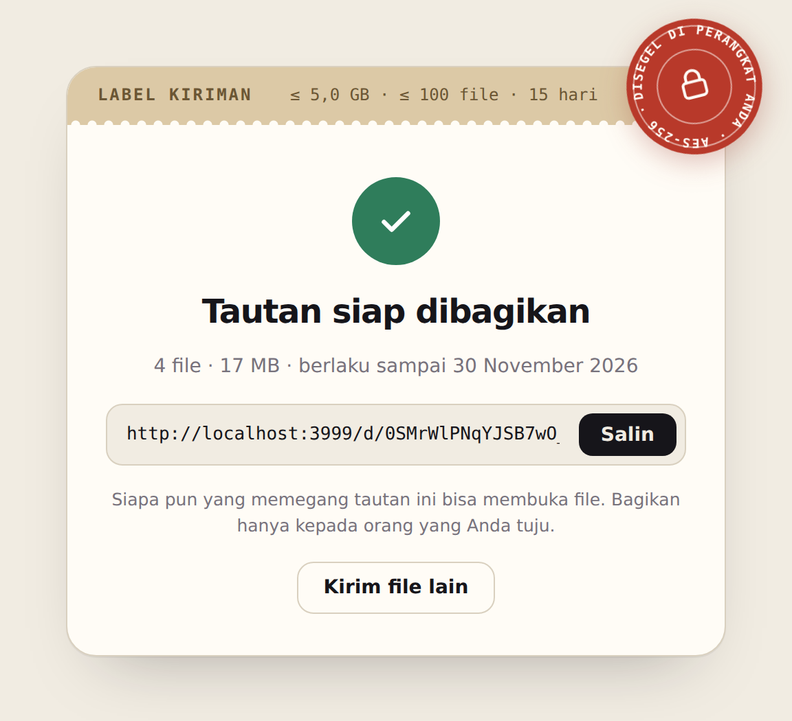
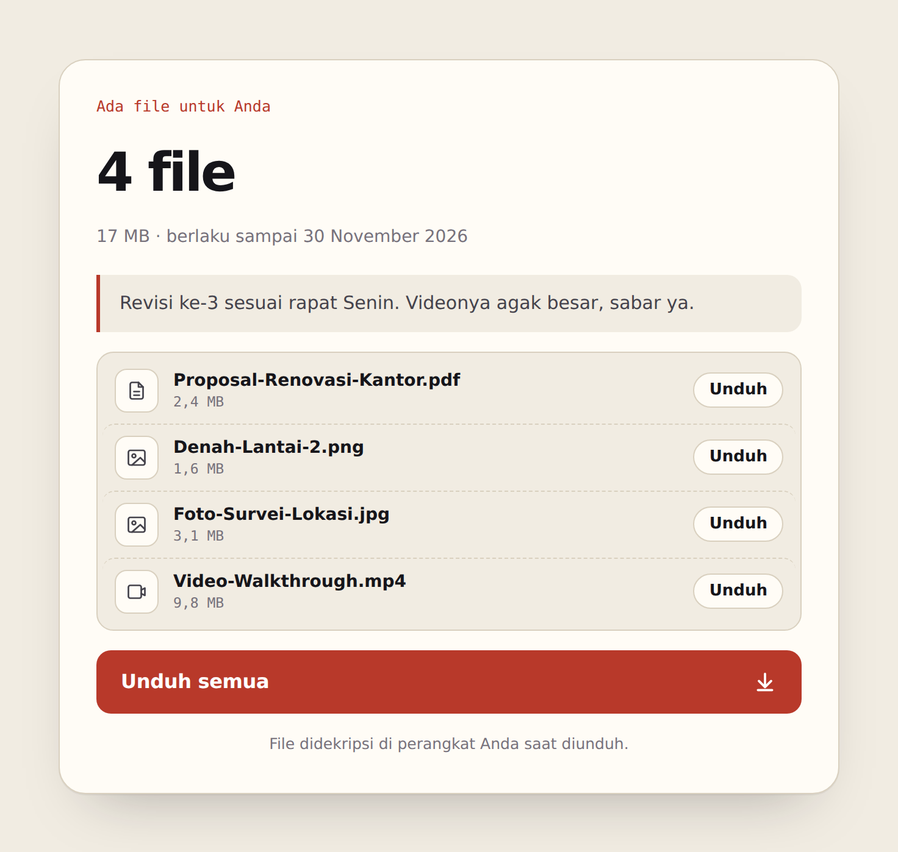
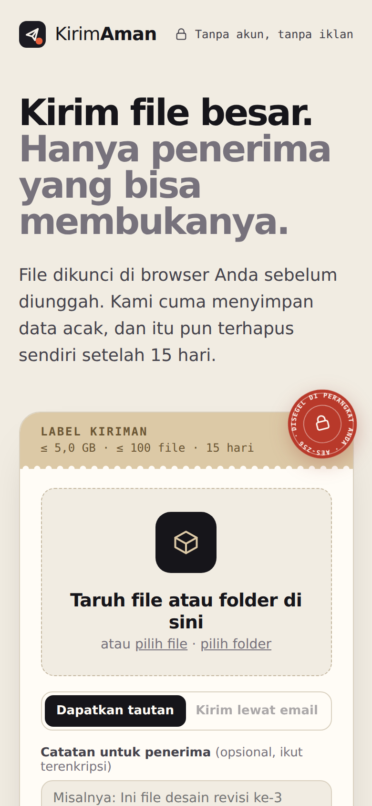

# KirimAman

Aplikasi web untuk mengirim file besar secara privat lewat **tautan** atau **email**. Terinspirasi dari fitur Send File di Internxt Send, tetapi dibuat ulang dari nol dengan desain dan kode sendiri.

- Tanpa akun. Seret file atau folder, lalu dapatkan tautan.
- **Enkripsi end-to-end (AES-256-GCM) di browser.** Server hanya menyimpan data acak, tidak bisa membaca isi file, nama file, atau catatan.
- Hingga **5 GB** dan **100 file** per kiriman (bisa diatur).
- Tautan dan file **terhapus otomatis setelah 15 hari** (bisa diatur).
- Kirim lewat email ke maksimal 50 penerima (opsional, butuh SMTP).
- Unggahan dipotong per 4 MB, dicoba ulang otomatis bila koneksi putus, dan bisa dibatalkan. Ada indikator kecepatan dan sisa waktu.
- Halaman unduh menampilkan daftar file, catatan pengirim, tanggal kedaluwarsa, tombol unduh per file, dan "Unduh semua". Di Chrome/Edge, file ditulis langsung ke disk, jadi file besar tidak memenuhi memori.
- Server tanpa dependensi wajib (Node.js murni). `nodemailer` hanya dipakai untuk fitur email.

## Tampilan



<table>
  <tr>
    <td align="center" width="33%"><br><sub><b>1. Pilih file</b>, tambahkan catatan</sub></td>
    <td align="center" width="33%"><br><sub><b>2. Dienkripsi &amp; diunggah</b> di browser</sub></td>
    <td align="center" width="33%"><br><sub><b>3. Tautan siap</b> dibagikan</sub></td>
  </tr>
  <tr>
    <td align="center" colspan="2"><br><sub><b>4. Halaman unduh</b> penerima: file didekripsi di perangkatnya</sub></td>
    <td align="center"><br><sub>Tampilan di HP</sub></td>
  </tr>
</table>

## Menjalankan di komputer sendiri

Butuh Node.js 18.17 atau lebih baru.

```bash
npm install        # hanya untuk fitur email; boleh dilewati
npm start          # buka http://localhost:3000
npm test           # uji otomatis ujung-ke-ujung
```

## Konfigurasi

Salin `.env.example` menjadi `.env`, lalu ubah sesuai kebutuhan. File itu dibaca otomatis saat server dijalankan.

| Variabel | Bawaan | Keterangan |
|---|---|---|
| `PORT` | `3000` | Port server |
| `DATA_DIR` | `./data` | Folder penyimpanan file terenkripsi |
| `MAX_BYTES` | 5 GB | Batas total per kiriman (byte) |
| `MAX_FILES` | `100` | Jumlah file maksimal per kiriman |
| `EXPIRY_DAYS` | `15` | Masa berlaku tautan (hari) |
| `RATE_LIMIT_PER_HOUR` | `30` | Kiriman baru maksimal per IP per jam |
| `TRUST_PROXY` | `0` | Isi `1` bila server berada di belakang Nginx/Cloudflare |
| `SMTP_HOST`, `SMTP_PORT`, `SMTP_SECURE`, `SMTP_USER`, `SMTP_PASS`, `SMTP_FROM` | – | Isi untuk mengaktifkan "Kirim lewat email" |

Untuk SMTP, Anda bisa memakai Gmail (dengan App Password), Brevo, Mailgun, Amazon SES, atau server email hosting Anda.

## Memasang di server (VPS)

### Dengan Docker

```bash
docker build -t kirimaman .
docker run -d --name kirimaman -p 3000:3000 -v kirimaman-data:/data --env-file .env --restart unless-stopped kirimaman
```

### Di belakang Nginx (HTTPS wajib)

Enkripsi di browser (Web Crypto) **hanya berjalan di HTTPS** (atau `localhost`). Pasang sertifikat, misalnya dengan Let's Encrypt, lalu:

```nginx
server {
    server_name kirim.domainanda.com;
    client_max_body_size 8m;          # tiap potongan unggahan ~4 MB
    proxy_request_buffering off;
    proxy_read_timeout 300s;
    location / {
        proxy_pass http://127.0.0.1:3000;
        proxy_set_header Host $host;
        proxy_set_header X-Forwarded-For $proxy_add_x_forwarded_for;
    }
    # listen 443 ssl; ... (diisi certbot)
}
```

Set juga `TRUST_PROXY=1`. Siapkan ruang disk sesuai perkiraan pemakaian, karena setiap kiriman bisa mencapai 5 GB dan disimpan selama 15 hari.

## Cara kerja keamanan

1. Browser pengirim membuat kunci AES-256 acak untuk setiap kiriman.
2. Setiap file dipotong per 4 MB. Tiap potongan dienkripsi AES-GCM dengan IV unik (nomor file + nomor potongan) dan penanda "potongan terakhir", sehingga potongan tidak bisa ditukar, diulang, atau dipotong diam-diam.
3. Nama file, ukuran, dan catatan disimpan dalam *manifest* yang juga terenkripsi.
4. Kunci ditaruh di bagian `#...` tautan, contohnya `https://domain/d/ID#KUNCI`. Browser tidak pernah mengirim bagian setelah `#` ke server.
5. Penerima membuka tautan, lalu browsernya mengunduh data terenkripsi dan mendekripsinya di perangkatnya sendiri.

### Perbedaan dengan Internxt Send (dari analisis kode sumbernya)

- Internxt mengirim kode pembuka kunci ke servernya (`plainCode`) saat membuat tautan. KirimAman **tidak pernah** mengirim kunci ke server dalam mode tautan.
- Dalam **mode email**, tautan lengkap (termasuk kunci) memang harus melewati server untuk dikirim ke penerima. Server tidak menyimpan tautan itu, tetapi untuk kerahasiaan maksimal gunakan mode "Dapatkan tautan" dan bagikan tautannya sendiri.
- Internxt memakai CAPTCHA dan penyimpanan cloud mereka. KirimAman memakai pembatas laju per IP dan menyimpan file di disk server Anda sendiri.

## Batasan yang perlu diketahui

- Di Firefox dan Safari, file didekripsi di memori sebelum disimpan, jadi file berukuran beberapa GB butuh RAM yang cukup. Chrome/Edge menulis langsung ke disk.
- Karena isinya terenkripsi, server tidak bisa memindai virus atau konten terlarang. Bila dibuka untuk umum, siapkan ketentuan layanan dan kontak pelaporan penyalahgunaan.
- Bila kunci (bagian setelah `#`) hilang dari tautan, file tidak bisa dibuka oleh siapa pun.

## Struktur

```
server.js            server HTTP + API + pembersihan otomatis
public/index.html    halaman kirim
public/download.html halaman unduh (/d/:id#kunci)
public/js/crypto.js  enkripsi end-to-end (dipakai browser & uji)
public/js/send.js    logika unggah
public/js/download.js logika unduh & dekripsi
test/e2e.test.js     uji otomatis
docs/screenshots/    gambar tampilan untuk README
```

## API (ringkas)

| Metode | Path | Fungsi |
|---|---|---|
| GET | `/api/config` | Versi aplikasi, batas & fitur yang aktif |
| POST | `/api/transfers` | Buat kiriman → `{id, token}` |
| PUT | `/api/transfers/:id/files/:i/chunks/:c` | Unggah potongan terenkripsi (Bearer token) |
| POST | `/api/transfers/:id/complete` | Tandai selesai, kirim email bila diminta |
| GET | `/api/transfers/:id` | Info kiriman (manifest terenkripsi) |
| GET | `/api/transfers/:id/files/:i` | Unduh data terenkripsi (mendukung `Range`) |

Lisensi: MIT.
